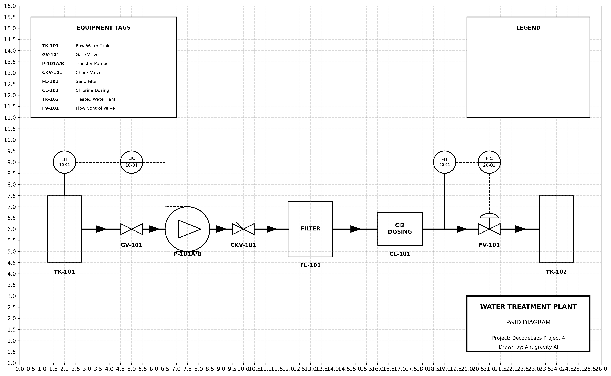

# Water Treatment P&ID Generator

## Project Goal
DecodeLabs Project 4: Build an automated, Python-based Piping and Instrumentation Diagram (P&ID) generator utilizing grid snapping, orthogonal routing, and strict ISA 5.1 formatting for a Water Treatment Plant.

## How to Run
1. Install dependencies: `pip install -r requirements.txt`
2. Run the main generator: `python main.py`
3. View the outputs in the `output/` directory (`water_treatment_pid.png` & `water_treatment_pid.pdf`). The validation report will print safely to your console.

## Symbol List
- **Equipment:** Tank (Vertical Vessel), Pump, Filter, Chlorine Dosing Unit
- **Valves:** Gate Valve, Check Valve, Globe Valve, Control Valve (Diaphragm Actuator)
- **Instruments:** Field-Mounted (Plain Circle), Control Room (Horizontal Line), PLC (Square with Diamond)

## ISA 5.1 Notes
- Instrument Tagging follows `XX-YYY-ZZ` formatting rules (Loop - Function Letters - Sequence).
- Signal Lines:
  - Process: Solid thick line
  - Electrical: Dashed line
  - Pneumatic: Solid line with `//` marks
  - Data link: Solid line with `o` marks
  - Capillary: Solid line with `x` marks

## The 6-Step Lifecycle
1. **Setup:** Initialize `matplotlib` canvas with 0.5 unit grid snapping.
2. **Place equipment:** Instantiate symbol functions at specific grid coordinates.
3. **Route pipes:** Draw orthogonal process connections snapping between registered ports with directional flow arrows.
4. **In-line instruments:** Overlay sensor nodes and flow components.
5. **Tagging and annotations:** Use `TagManager` for auto-tagging loops and components. Title blocks and legends are added.
6. **Validation:** Check the diagram via `validator.py` for unconnected ports, untagged items, missing tags, size mismatches, and unclosed loops. Ensure 0 critical errors.

## Screenshot

